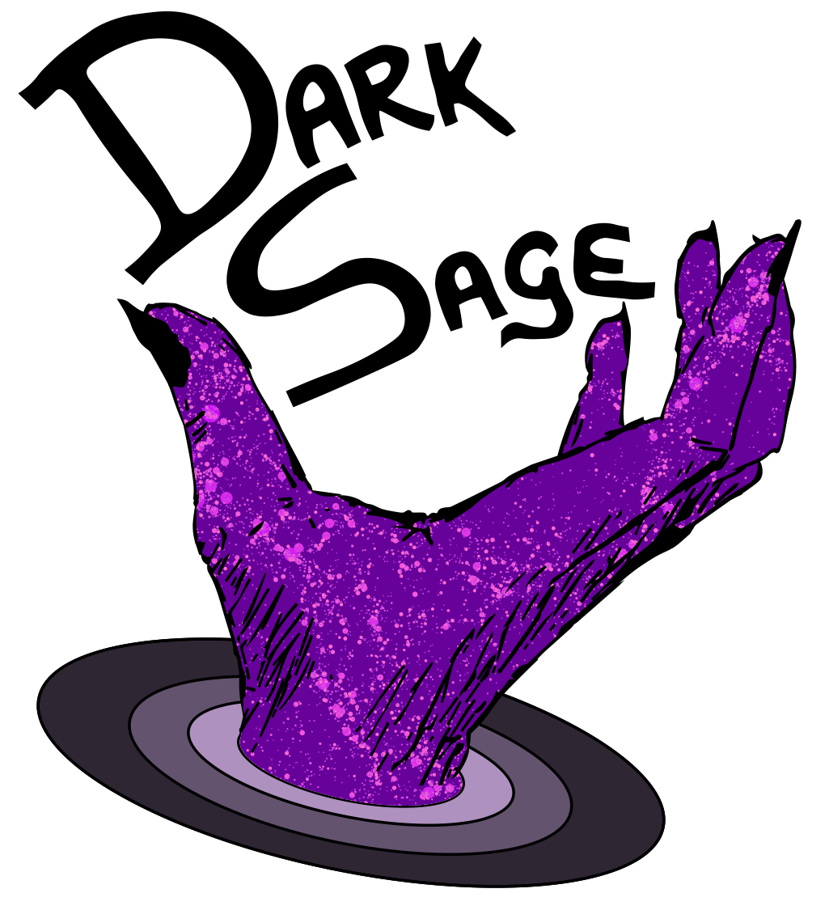

DARK SAGE is a semi-analytic model of galaxy formation, focussed on detailing the structure and evolution of galaxies' discs.  The latest version of the model is described in full in the paper by [Stevens et al. (2024)](https://ui.adsabs.harvard.edu/abs/2024PASA...41...53S/abstract). Please cite this paper for general references to the model, especially when the model is used in a publication.  

The original version of DARK SAGE was presented in [Stevens, Croton & Mutch (2016)](http://adsabs.harvard.edu/abs/2016MNRAS.461..859S), building on the [SAGE](https://github.com/darrencroton/sage/) model. Updates from the original version of DARK SAGE were presented in [Stevens & Brown (2017)](http://adsabs.harvard.edu/abs/2017MNRAS.471..447S) and [Stevens et al. (2018)](https://arxiv.org/abs/1806.07402). DARK SAGE is also listed on the [Astrophysics Source Code Library](http://ascl.net/1706.004).

DARK SAGE will run on any N-body simulation whose trees are organised in a supported format and contain a minimum set of basic halo properties.  Galaxy formation models built using the 2016 version of DARK SAGE on the Millennium simulation can be downloaded at the [Theoretical Astrophysical Observatory (TAO)](https://tao.asvo.org.au/).

The code-base, written in C, should function as is, provided you have GSL installed.  A purpose-made Python wrapper exists for installing Dark Sage, achieved by entering  `python compile.py` into the command line. This will ask for a parameter file, which is optional.  This is in case there are any global variables in Dark Sage that are otherwise hard-coded and need updating (which compile.py will take care of based on that parameter file).  Otherwise, one can install simply with `make`.  Once installed, please run the test script with `python test.py` to make sure everything is working correctly.

To run DARK SAGE in serial, you need only point to a parameter file:  
`./darksage {path}/{parameter file name}`  
e.g.:  
`./darksage input/millennium.par`

DARK SAGE can be run with MPI, but only in an improper hacky way at the moment.  If you wish to try this, you shouldn't need to change anything in the Makefile if it's already running in serial.  Each processor will work on a separate merger tree file.  Simply run as:  
`mpirun -np {number of processors} ./darksage {path}/{parameter file name}`  
e.g.:  
`mpirun -np 8 ./darksage input/millennium.par`

Queries, comments, and concerns can be emailed to Adam Stevens: adam.rh.stevens@gmail.com

DARK SAGE logo designed by A. R. H. Stevens, G. H. Stevens, and S. Bellstedt.  Please use the official logo in talks when presenting results from the model.
